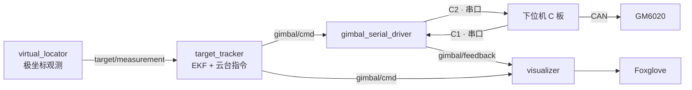
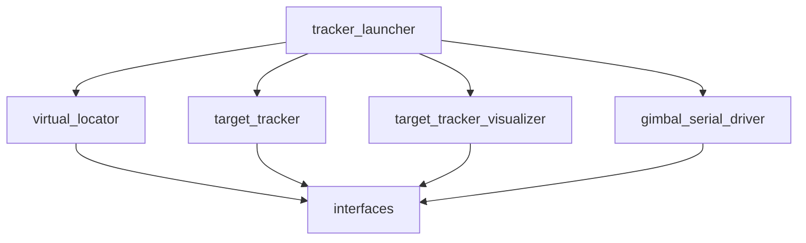
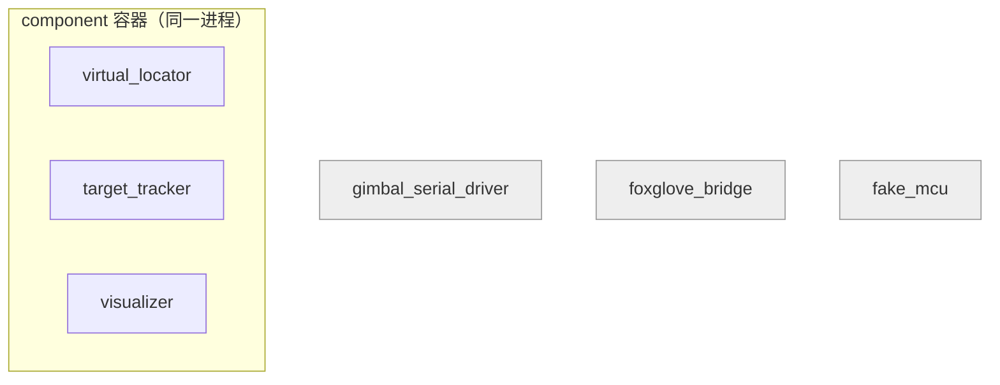

<h1 align="center">Part of Architecture</h1>

这份文档是整套材料的总纲，建议最先读。它回答三个问题：这个项目由哪几部分组成，上位机的代码为什么这样分功能包，以及题目为什么只挖那几个地方。不涉及算法推导和协议细节，那些交给后面的专项文档。

读完之后，你对整个工程应该有一张完整的地图：知道每个包在干什么、数据从哪流到哪、哪些代码是给你的、哪些要你自己写。

## 目录

- [一、这套系统要做什么](#sec1)
- [二、整体架构：上位机、下位机、电机](#sec2)
- [三、上位机的功能包划分](#sec3)
- [四、运行时：组件容器与进程划分](#sec4)
- [五、为什么这样出题](#sec5)
- [六、fake 与 real 并存的用意](#sec6)

<a id="sec1"></a>
## 一、这套系统要做什么

题目模拟 RoboMaster 自瞄链路里的一段完整闭环。一个固定在站点上的设备观测一个运动目标，估计它的位置和速度，并让一台单轴云台始终指向它。

链路是这样的：

```text
传感器给出极坐标观测 (r, θ)
    → 估计目标状态（位置、速度、加速度）
    → 算出云台应该转到哪个角度
    → 通过串口发给下位机
    → 下位机驱动电机转到这个角度
    → 把电机实际角度回传
    → 可视化里对比「想指哪」和「实际指哪」
```

把它拆开看，涉及两件事：**估计**（从带噪的极坐标观测里推出目标状态）和**控制**（把目标状态变成电机的转动）。它们分别落在两台计算机上。

<a id="sec2"></a>
## 二、整体架构：上位机、下位机、电机

系统由三部分组成。

**上位机**是运行 ROS 2 的电脑。它做估计和决策：跑 EKF、算云台角度、编码发送、解析反馈、可视化。这些计算对算力要求不高，但需要灵活改参数和逻辑，所以放在可以随时重编译的电脑上。

**下位机**是 RoboMaster 开发板 C 型（STM32F407）。它做实时控制和执行：用 1 kHz 的串级 PID 驱动电机，处理串口收发，管理安全状态。这些对实时性和稳定性要求高，放在单片机里。

**电机**是一台 GM6020，构成云台的 yaw 轴。

三者连起来：



上位机把角度命令发下去，下位机驱动电机并把结果回传，可视化把两边画在一起。硬件接线、坐标系和角度约定在 `Part_of_Frames.md` 里。

<a id="sec3"></a>
## 三、上位机的功能包划分

上位机由六个 ROS 包组成，职责分得很清楚。

| 包 | 职责 | 依赖 |
|---|---|---|
| `interfaces` | 自定义消息：观测、云台指令、反馈、串口状态 | 无 |
| `virtual_locator` | 回放极坐标观测，充当传感器 | `interfaces` |
| `target_tracker` | EKF 估计与云台指令，算法核心 | `interfaces` |
| `target_tracker_visualizer` | 发布 Marker 和 TF，供 Foxglove 显示 | `interfaces` |
| `gimbal_serial_driver` | 串口收发，以及软件下位机 `fake_mcu` | `interfaces` |
| `tracker_launcher` | 一键启动所有节点，组装容器 | 上面全部 |

依赖方向是单向的：所有包都依赖 `interfaces`，但 `interfaces` 不依赖任何包。启动编排 `tracker_launcher` 依赖全部，没有包反过来依赖它。



这样拆有几条理由：

**消息单独成包。** 消息是多个包共享的契约，谁都要用。把它独立出来，其它包的依赖都指向它，改动一处不用牵动别处。

**模拟器和算法分开。** `virtual_locator` 是数据来源，不是算法。在真实场景里，它会被真正的传感器驱动替换。它和 EKF 的生命周期、依赖都不同，所以单独一个包。

**可视化单独成包。** 可视化依赖比较重，而且属于调试工具，机器人实际运行时不一定需要。独立成包后，核心算法可以不带它一起部署。

**串口和软件下位机在一起。** `gimbal_serial_driver` 既能连真串口，也能跑 `fake_mcu` 软件下位机。两者都是「上下位机之间的那条通信」，放在一起合理。

**启动编排单独成包。** 怎么把节点组织起来是独立的一件事，和算法、通信都无关。`tracker_launcher` 只负责组装，不含业务逻辑。

<a id="sec4"></a>
## 四、运行时：组件容器与进程划分

代码在文件里是分包的，跑起来时的进程划分则是另一层考虑。

仿真/回放节点、EKF 跟踪节点、可视化节点这三个计算节点，放进**同一个** component 容器进程里，开启进程内通信。这样它们之间传话题走的是进程内的零拷贝，不经过网络栈，延迟更低。它们都是纯计算，互不阻塞。

串口驱动、软件下位机、Foxglove bridge 则各起**独立进程**。原因是：

- 串口驱动做的是 I/O，可能阻塞。放进计算容器会拖累 EKF 和可视化的定时器；
- 软件下位机模拟一块板子，本来就该是「独立的一台设备」；
- Foxglove bridge 是对外提供 WebSocket 的工具，和业务无关。



一句话概括：**延迟敏感的纯计算放一个进程，I/O 和外部工具各放各的**。

<a id="sec5"></a>
## 五、为什么这样出题

题目只挖空四个文件，对应四条考察主线。选择这些地方，是想让学生完整走一遍「从算法到硬件」的链路，同时避免重复考察已经练过的东西。

**EKF 数学（`kalman_filter.cpp`）。** 这是本题和普通线性卡尔曼滤波的分水岭：观测是极坐标，是非线性的，必须用 EKF。雅可比、极坐标噪声换算、角度环绕、离群点门控，都集中在这里。

**云台控制数学（`gimbal_command.cpp`）。** 把 EKF 的未来状态变成云台该指的角度和角速度前馈。考的是坐标系转换、`atan2`、角速度求导，以及断流时的命令阶段决策。

**系统集成（`tracker_node.cpp`）。** 观测时间戳怎么算 `dt`、EKF 什么时候重新初始化、断流怎么处理，这些是纯算法之外、但决定整条链路正确与否的部分。

**串口协议工程（`protocol.cpp`）。** 二进制帧的编解码、CRC、流式解析与重同步，是另一种完全不同的工程能力。

之所以把别的部分都完整给出，是因为它们要么前几道题已经考过（ROS 节点、订阅发布、参数、launch），要么不适合作为短时间内的笔试内容（环境搭建、Foxglove 布局、STM32 固件本身）。题目希望你把精力放在算法和协议这两块真正有区分度的地方。

<a id="sec6"></a>
## 六、fake 与 real 并存的用意

这套工程准备了两条下位机路径：软件下位机 `fake_mcu` 和真实 C 板。

它们共享同一份 `Shared/` 代码——协议、PID、云台控制逻辑——只是底层不同：`fake_mcu` 在一段伪终端上和一台电机模型上运行，真实板子用物理串口和 CAN 总线。对上位机来说，两者发的是同一种 C1、收的是同一种 C2，所以**上位机代码完全不用区分**。

这样设计的目的有两个。一是**没有硬件也能开发**：你可以先跑 `mcu:=fake`，把 EKF、云台指令、协议全部调通，再去接真板子。二是**行为一致**：用 fake 调通的结果，接到真板上不会因为逻辑不同而对不上。真板带来的是真实的延迟、噪声和硬件限制，而不是另一套逻辑。

---

祝顺利 😊😊😊

<div align="right">—— 浙江大学 RoboMaster 算法组</div>
