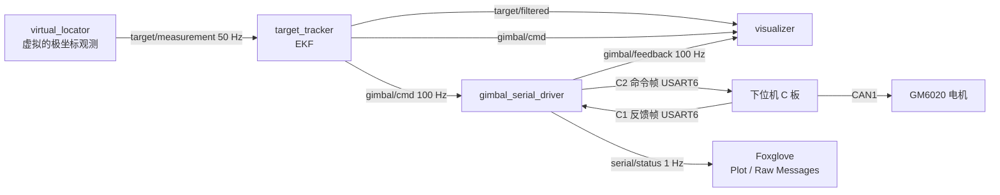
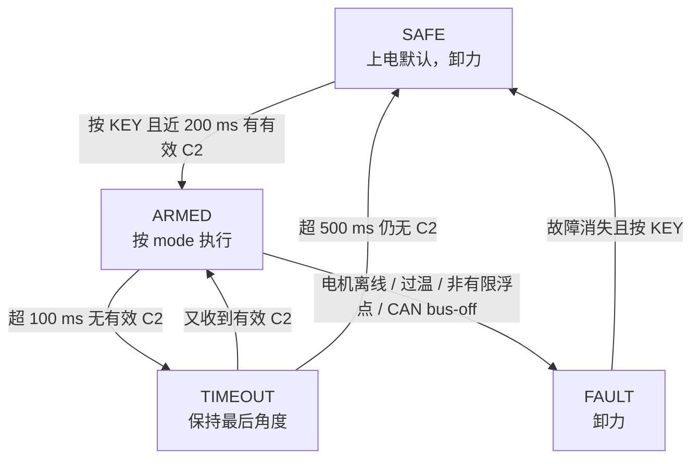

<h1 align="center">Part of Communication</h1>

这份文档讲系统层面的协作：上位机和下位机各自做什么、数据怎么走完一圈、延迟和前馈怎么配合、安全机制怎么兜底，以及链路出问题时怎么退化。字节级别的帧格式、CRC 和流式解析在 `Part_of_Serial.md` 里，这里只讲整体。

读完之后，你应该能回答：一帧观测从进入到电机转动，中间经过哪几步；指令频率为什么比观测频率高；`predict_dt` 补的是哪一段时间；拔掉串口会发生什么。

## 目录

- [一、为什么分成上位机和下位机](#sec1)
- [二、一帧控制命令的闭环](#sec2)
- [三、频率、延迟与前馈](#sec3)
- [四、安全状态机](#sec4)
- [五、异常与恢复](#sec5)
- [六、这套协作设计的取舍](#sec6)

## 一、为什么分成上位机和下位机

整套系统里有两台计算机，各自做擅长的事。

**上位机**是运行 ROS 2 的电脑。它擅长计算和决策：跑 EKF 估计目标状态、算出云台应该转到什么角度、统计往返时延。这些操作对算力要求不高，但对逻辑和参数灵活性要求高，改一行代码就能重新编译运行，适合放在这里。

**下位机**是 RoboMaster 开发板 C 型（STM32F407）。它擅长实时控制：接收上位机的角度命令，用串级 PID 驱动 GM6020 电机转到指定位置，再把实际角度和状态回传。这一层对实时性要求高（控制周期 1 kHz）、对稳定性要求高（看门狗、限位、过温保护），一旦跑起来不希望频繁改代码。

分两层的好处是职责清晰：上位机只管下达高层指令，下位机只管执行控制。上位机不需要知道电机怎么驱动、CAN 总线怎么编解码；下位机不需要知道目标怎么估计、预测怎么算。两边之间的接口就是两个话题：`gimbal/cmd` 发下去，`gimbal/feedback` 发上来。

## 二、一帧控制命令的闭环

一个完整的控制周期，数据从观测到电机再到可视化，走完一圈：

展开每一步：

1. `virtual_locator` 按原始时间戳发布极坐标观测 `(r, θ)`，频率 50 Hz。
2. `target_tracker` 收到观测，跑一轮 EKF（先 `predict` 再 `update`），得到目标状态估计。同时按固定频率（默认 100 Hz）发 `gimbal/cmd`，里面是云台目标 yaw 和角速度前馈。
3. `gimbal_serial_driver` 把 `gimbal/cmd` 编码成 C2 二进制帧，通过串口发给 C 板。
4. C 板解码 C2，按命令里的 mode 执行。TRACK 模式下用串级 PID 驱动电机转到目标角度。
5. C 板每 10 ms 编码一帧 C1，包含电机实际角度、温度、状态等，通过串口发回。
6. `gimbal_serial_driver` 收到 C1，解析成 `gimbal/feedback` 话题发布。同时统计收发帧数、CRC 错误和往返时延，每秒发一次 `serial/status`。
7. `visualizer` 订阅以上所有话题，在 Foxglove 里画出轨迹、指令射线和反馈射线。

这条链路里有两个频率值得注意：观测是 50 Hz，但指令和反馈都是 100 Hz。指令频率不等于观测频率，是有意为之——下一节解释原因。

## 三、频率、延迟与前馈

### 3.1 三个频率

| 环节 | 频率 | 说明 |
|---|---:|---|
| 观测 `target/measurement` | 50 Hz | 传感器采样率，数据里有断流 |
| 指令 `gimbal/cmd` | 100 Hz | 上位机定时器发，和观测到达无关 |
| 反馈 `gimbal/feedback` | 100 Hz | 下位机每 10 ms 回传一帧 C1 |

指令频率高于观测频率，是因为云台需要比观测更频繁地收到目标。即使观测断流了（比如遮挡），上位机仍然按 100 Hz 发指令：用运动模型把状态外推到当前时刻，加上 `predict_dt` 的提前量，算出该指哪。这样在两次观测之间的 20 ms 空档里，电机不会停下来等。

### 3.2 链路延迟的来源

从目标被观测到，到电机实际转到那个角度，延迟来自三段：

- **EKF 计算**：可忽略，微秒级；
- **串口往返**：C2 编码 → USART 发送 → C 板接收解码 → 电机驱动 → C1 编码 → USART 发送 → 上位机解析。实测 RTT 约 10 ms；
- **电机响应**：从速度环收到参考到转子实际转过去，受 PID 增益和机械惯性决定，是最大的延迟来源。

这三段加起来就是「从命令发出到电机到位」的总滞后。实测中，关掉前馈后这个滞后约 60 ms；开前馈后等效滞后降到约 5 ms。

### 3.3 `predict_dt` 补的是什么

上位机不是在「目标此刻在哪」的地方瞄准，而是在「目标在命令到达电机那一刻会在哪」的地方瞄准。`predict_dt` 就是这段提前量。

它由 `tracker_node` 的定时器每 10 ms 算一次：把 EKF 状态外推 `predict_dt` 秒（默认 0.08 s），用外推后的位置算云台 yaw。这样命令发出去、经过串口和电机延迟到达时，电机刚好对准目标的新位置。

### 3.4 角速度前馈

`predict_dt` 让指令角度提前了，但电机要追上这个角度仍然有滞后。前馈在速度上补这一段：上位机把目标的角速度 `yaw_vel` 算出来，和 yaw 一起发下去。下位机把它加到速度环的参考上，让电机「知道目标在转」，不用等角度误差出现才反应。

前馈和 `predict_dt` 配合，一个补角度提前量，一个补速度滞后。实测数据：两者都开，跟踪误差 RMS 约 0.5°；关掉前馈，RKS 升到约 0.9°，等效滞后从 5 ms 增到 60 ms。

## 四、安全状态机

下位机固件里有一套状态机，保证通信异常或程序卡死时电机不会乱转。上位机不能远程控制这个状态，只能通过命令的 `mode` 字段间接影响。

几个关键点：

- **上电就是 SAFE**，电机卸力。要按一次 C 板上的物理 KEY 键才进入 ARMED，而且必须在最近 200 ms 内收到过有效 C2。上位机无法远程解锁，这是刻意的安全设计。
- ARMED 下超过 100 ms 没收到有效 C2，进入 TIMEOUT，保持最后的角度不动。如果指令恢复，自动回 ARMED；如果继续断 500 ms，回 SAFE。
- 电机离线、过温、连续收到非有限浮点数或 CAN bus-off，直接进 FAULT，卸力。故障消失后按 KEY 才回 SAFE。

### 4.1 指示灯与蜂鸣器

板上有 RGB 灯和蜂鸣器，固件把状态和错误直接反映出来，不接电脑也能从灯语判断链路走到哪一步。这段逻辑在 `App/app.c` 的 `indicator_update()` 里。

| 灯语 | 出现条件 | 含义 |
|---|---|---|
| 白灯闪一下，短鸣 | 上电自检 | 固件启动，随后进入 SAFE |
| 蓝灯慢闪（1 Hz） | SAFE，约 200 ms 内没有 C2 | 还没收到上位机数据 |
| 蓝灯常亮 | SAFE，链路通且电机在线 | 就绪，等按 KEY 解锁 |
| 蓝紫交替 | SAFE，有数据但电机不在线 | C2 到了，但电机没接好或没供电 |
| 绿灯，越接近越亮 | ARMED，`mode=TRACK` 且目标有效 | 正在跟随目标 |
| 黄灯闪一下 | ARMED，本帧被标为离群点 | 上位机报 `outlier`，仅提示 |
| 黄灯慢闪 | ARMED，`HOLD` 或目标无效 | 保持当前角度 |
| 红灯快闪（5 Hz） | TIMEOUT | 指令中断超过 100 ms |
| 红灯常亮 | FAULT | 硬件故障，卸力，需按键清除 |

## 五、异常与恢复

### 5.1 丢包

串口上可能出现两种丢帧。一种是 C2 到下位机丢了，下位机的 `echo_seq` 不递增，上位机能从序列号跳变检测到。另一种是 C1 到上位机丢了，上位机收到的帧率会低于 100 Hz。

`gimbal_serial_driver` 把这些统计在 `serial/status` 话题里，每秒发一次，包含累计收发帧数、CRC 错误数、序列号跳变和重连次数。在 Foxglove 的 Plot 面板里画 `rtt_ms_mean` 和 `rx_rate_hz` 就能直接看到链路健康状况。

### 5.2 断流

观测断流和串口断流是两件事。观测断流指 `target/measurement` 停止发布（数据里有 3 段 0.2~0.4 s 的遮挡），上位机用运动模型外推，超过 `max_coast` 就停。串口断流指物理连接断开，`gimbal_serial_driver` 检测到后自动重连，期间 `gimbal/feedback` 停止发布。

两者在可视化上的表现不同：观测断流时黄色指令射线继续动（在按模型外推），但绿色轨迹短暂停顿；串口断流时青色反馈射线消失，左上角状态栏显示 MCU 无反馈，下位机按状态机超时进入 TIMEOUT 或 SAFE。

### 5.3 拔线

拔掉 USB-TTL 后，上位机的串口驱动会反复尝试重连。下位机一侧在 100 ms 内收不到 C2 就进入 TIMEOUT，保持最后角度；500 ms 后回 SAFE，电机卸力。重新插上后，上位机自动重连，C2 恢复，下位机从 SAFE 回 ARMED 需要再按一次 KEY。

`fake_mcu` 支持两个故障注入参数来模拟这些：`drop_rate` 让一定比例的反馈帧随机丢失，`bit_error_rate` 让每个比特以一定概率翻转，用来测试上位机的 CRC 纠错和重同步。

## 六、这套协作设计的取舍

最后说几条设计选择背后的理由。

**PID 放在板子上，不放上位机。** 电机控制周期 1 kHz，对实时性要求高。ROS 2 的回调延迟不确定，上位机不一定能保证 1 ms 的周期。把 PID 放在 STM32 的定时器中断里，周期严格稳定；上位机只发目标角度，频率 100 Hz 就够。

**指令和反馈分成两条独立话题。** 指令是上位机→下位机，反馈是下位机→上位机，方向不同，频率恰好都是 100 Hz 但互相独立。分开的好处是任何一个方向的延迟或丢包都能单独观察，可视化里画成两条射线，一眼看出跟踪误差。

**指令频率独立于观测频率。** 如果指令只在有观测时才发，断流期间电机就停了，恢复后要重新追。让指令以固定 100 Hz 发，断流时用模型外推继续发，电机不会停，恢复时差距小。

**上位机不碰安全状态机。** 解锁必须物理按键，故障清除也要按键确认。这样即使上位机程序崩溃、串口断开或发疯，下位机也会按自己的状态机安全退化，不会因为上位机的 bug 而失控。

---

祝顺利 😊😊😊

—— 浙江大学 RoboMaster 算法组

