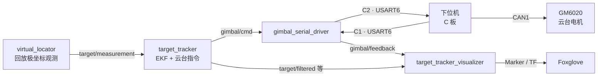

<h1 align="center">Part of Frames</h1>

这份文档讲两件事：本题整套系统由哪些部分组成、它们怎么连起来；以及系统里所有位置和角度分别属于哪个坐标系。不涉及公式推导，建议在做题之前先读一遍。

坐标系如果没搞清楚，后面 EKF 和云台指令很容易写对公式却指向错误的方向，而且不容易自己发现。这份文档先把「谁在哪、朝哪」定下来。

## 目录

- [一、任务背景](#sec1)
- [二、系统组成](#sec2)
- [三、坐标系](#sec3)
- [四、角度约定](#sec4)
- [五、可视化里各条线的含义](#sec5)

<a id="sec1"></a>
## 一、任务背景

本题模拟 RoboMaster 自瞄链路里的一段：一个固定在站点上的设备观测一个运动目标，估计它的位置和速度，并让一台单轴云台指向它。

具体设定是：

- 目标在水平面上沿一条对数螺旋绕原点运动；
- 站点固定在原点右侧 10 m 处，即 $S = (10, 0)$；
- 观测设备装在站点上，它测到的是目标相对站点的距离 $r$ 和方位角 $\theta$，也就是极坐标，而不是目标的坐标；
- 云台也装在站点上，只有 yaw 一个自由度，要让它始终指向目标。

上位机要做的是：用极坐标观测估计目标状态（位置、速度、加速度），算出云台应该转到哪个角度，通过串口把角度发给下位机；下位机驱动电机把云台转到这个角度，并把电机当前角度回传上来。整条链路要能看出通信延迟、丢帧和电机响应滞后。

<a id="sec2"></a>
## 二、系统组成

系统分三部分：上位机、下位机、电机。

上位机是运行 ROS 2 的电脑，它由几个 ROS 包组成：

| 包 | 作用 |
|---|---|
| `virtual_locator` | 回放极坐标观测，充当「传感器」 |
| `target_tracker` | EKF 估计目标状态，算出云台指令 |
| `gimbal_serial_driver` | 串口收发，把指令编码成 C2、把反馈解析成 C1 |
| `target_tracker_visualizer` | 发布可视化消息和 TF |
| `tracker_launcher` | 一键启动以上节点 |

下位机是 RoboMaster 开发板 C 型（STM32F407）。它通过 USART6 接收上位机的命令，通过 CAN1 驱动电机，并把电机状态回传。固件在 `lower_computer/gimbal_fw`。

电机是一台 GM6020，构成云台的 yaw 轴。只接了一台电机，所以只有单轴。

整条链路：



上位机把 yaw 指令（C2）发下去，下位机驱动电机，再把电机实际角度（C1）发上来。可视化把指令和反馈都画出来，两者之间的夹角就是跟踪误差。

### 2.1 软件下位机（fake MCU）

没有 C 板时，用 `fake_mcu` 代替。它是一个 ROS 节点，在一段伪终端上模拟一块 C 板：接收上位机发来的 C2，按和下位机固件同一份控制代码（协议、PID、GM6020 模型、安全状态机）算出反馈，再以 C1 发回去。

它和真实 C 板的区别只有底层：真实板子通过物理串口和 CAN 总线，`fake_mcu` 通过一段伪终端和电机模型。对上位机来说，两者发的是同一种 C1、收的是同一种 C2，所以上位机代码可以完全不区分。

`fake_mcu` 还支持两个故障注入参数：`drop_rate` 让一定比例的反馈帧丢失，`bit_error_rate` 让每个比特以一定概率翻转。用来测试上位机的断流处理和 CRC 纠错。

启动时用 `mcu:=fake`：

```bash
ros2 launch tracker_launcher tracker.launch.py mcu:=fake
```

### 2.2 真实下位机（C 板 + 电机）

启动时用 `mcu:=real`：

```bash
ros2 launch tracker_launcher tracker.launch.py mcu:=real port:=/dev/ttyUSB0
```

真实下位机有几个和 fake 不同的地方，做题时会遇到：

- 上电默认 SAFE，电机卸力。要按一次板上的 KEY 键才进入 ARMED，之后才按上位机的输出命令cmd驱动电机；
- 控制是串级 PID：角度环（只用 P）输出目标角速度，速度环（PI）输出电机电压，上位机给的角速度前馈加在速度环参考上；
- 有机械限位，指令超出限位会被钳位；
- 有看门狗，通信或程序异常时自动复位；
- 固件里有一个输出缩放系数，首次测试会调小，防止电机猛冲。

`fake_mcu` 和真实固件共享同一套控制逻辑，所以用 fake 调通的上位机，接真板行为基本一致。

<a id="sec3"></a>
## 三、坐标系

系统里有三个坐标系。名字在代码和 TF 里都是固定的。

### 3.1 map：世界系

`map` 是全局惯性系，描述整个场景。

- 原点在螺旋中心，也就是坐标原点 $(0,0)$；
- $x$ 轴向右， $y$ 轴向上；
- 所有运动都发生在水平面内， $z$ 恒为 0。

目标的真实位置、EKF 估计出的 $(p_x, p_y)$ 都在 `map` 下表达。

### 3.2 station：站点系

`station` 固定在站点 $S = (10, 0)$，和云台、观测设备装在同一个位置。它相对 `map` 是静止的。

它和 `map` 的差别是一个平移加一个旋转：

- 平移：原点从螺旋中心挪到 $(10, 0)$；
- 旋转：`station` 的 $x$ 轴指向云台的零位方向，也就是 `gimbal_heading = π`，即朝世界 $-x$、正对螺旋中心。

`station` 的原点就是「云台转轴的位置」。云台角度都相对这个坐标系来说。

### 3.3 gimbal：云台系

`gimbal` 挂在 `station` 下面，代表云台当前实际朝向。它相对 `station` 的旋转角就是电机的实际 yaw，来自下位机回传的反馈。

电机转，`gimbal` 就跟着转；想让它指哪，就是让这个 yaw 对准目标。

### 3.4 TF 树

三者的关系是一棵树：


- `map → station` 是静态的：站点位置和零位朝向都不变，发一次即可；
- `station → gimbal` 是动态的：电机每动一点，这段变换就要更新。

可视化节点会发布这两段 TF，所以在 Foxglove 的 3D 面板里能直接看到三个坐标系和它们的朝向。

<a id="sec4"></a>
## 四、角度约定

### 4.1 观测角度

传感器从站点出发，给出距离和方位：

$$
r = \sqrt{(p_x - s_x)^2 + (p_y - s_y)^2}, \qquad
\theta = \mathrm{atan2}(p_y - s_y,\ p_x - s_x)
$$

这里的 $\theta$ 是世界系下的方位角，衡量的是「站点到目标」这条连线相对世界 $x$ 轴的方向，取值范围 wrap 到 $(-\pi, \pi]$。

### 4.2 云台角度

云台指令里的 `yaw` 不是世界方位角，而是相对云台零位的角度。因为零位朝 $-x$，也就是朝 `gimbal_heading = π`，两者的关系是：

$$
\text{gimbal\_yaw} = \mathrm{wrap}\big(\theta - \text{gimbal\_heading}\big)
        = \mathrm{wrap}\big(\mathrm{atan2}(p_y - s_y,\ p_x - s_x) - \pi\big)
$$

约定：

- `yaw = 0` 时，云台指向零位方向（正对螺旋中心）；
- **yaw 为正表示俯视逆时针**（从 $+z$ 方向往下看，向左转）；
- 机械限位约 $\pm 35^\circ$，指令超出会被钳位。

### 4.3 为什么会有 ±π 跨越

站点朝 $-x$，而目标又在绕原点转圈，所以目标的方位角会反复经过 $\pm\pi$ 附近。在可视化里，这表现为云台射线有时向左、有时向右扫过接近 $180^\circ$ 的位置；在 EKF 里，则表现为残差的方位分量必须在 $\pm\pi$ 处做环绕处理。这两件事都来自同一个几何事实，详见 `Part_of_EKF.md`。

<a id="sec5"></a>
## 五、可视化里各条线的含义

理解了坐标系，就能看懂可视化：

| 元素 | 含义 |
|---|---|
| 红色轨迹 | 原始观测，由 $(r, \theta)$ 换算到 `map` 的散点连线 |
| 绿色轨迹 | EKF 滤波后的目标位置 |
| 黄色射线 | 上位机发出的云台指令角度（从站点出发） |
| 青色射线 | 下位机回传的电机实际角度 |
| 灰色虚线 | 云台机械限位 $\pm 35^\circ$ |
| 绿色球 | 站点 $S$ |

黄线和青线的夹角就是当前跟踪误差：黄线代表「想指哪」，青线代表「实际指哪」。两条线几乎重合就说明跟得上；青线贴着灰线不动，就是电机顶到限位了。

---

祝顺利 😊😊😊

<div align="right">—— 浙江大学 RoboMaster 算法组</div>
