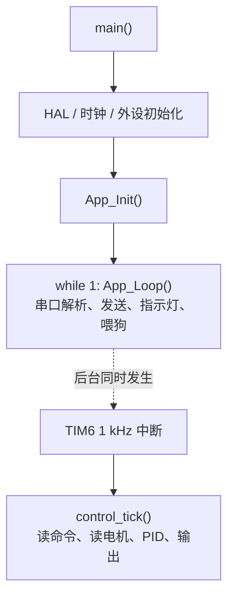
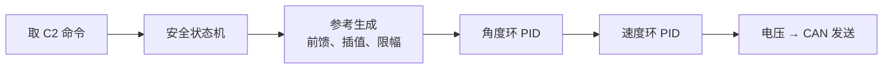

<h1 align="center">Part of General STM32</h1>

这份文档是下位机的通识知识，写给写上位机的人看。目的不是教你写固件，而是让你知道电控板子在做什么，从而看懂 C1 反馈里每个数是怎么来的、为什么上电是 SAFE、为什么会有超时和限位。读完之后，你在调上位机时遇到反馈异常，能知道该往固件的哪个方向去找。

不需要提前会单片机。文中出现的 HAL、CubeMX、DMA 这些词，第一次出现时会解释它在干什么。

## 目录

- [一、为什么上位机的人也要读下位机](#sec1)
- [二、STM32 工程的基本结构](#sec2)
- [三、程序怎么跑起来](#sec3)
- [四、上位机需要看的几类文件](#sec4)
- [五、控制链路：从命令到电机](#sec5)
- [六、通信链路：USART6 的收发](#sec6)
- [七、和上位机对齐：C1/C2 字段的来源](#sec7)

<a id="sec1"></a>
## 一、为什么上位机的人也要读下位机

上位机只通过 C1/C2 两个话题和下位机打交道，看起来不需要知道板子内部的实现。但在几种情况下，不了解下位机会卡住：

- 反馈里 `state` 是 SAFE，电机不动，你不知道是没解锁还是没接电机；
- `yaw_ref` 和 `yaw` 不一样，你不确定是上位机命令的问题还是下位机控制的问题；
- 前馈 `yaw_vel` 发下去好像没效果，你不确定下位机到底用了没有；
- 拔线后反馈消失，你不知道板子会不会乱转。

这些问题的答案都在固件里。知道下位机的控制结构和通信结构，才能正确解释反馈、定位问题。

<a id="sec2"></a>
## 二、STM32 工程的基本结构

下位机固件是一个 STM32 的 CubeMX 工程。理解它的目录划分，就知道哪些文件是自动生成的、哪些是人写的、上位机该看哪些。

### 2.1 配置文件与自动生成的部分

工程根目录下有一个 `gimbal_fw.ioc` 文件，它记录的是**外设配置**：哪个引脚接串口、波特率多少、哪个定时器做 PWM、CAN 怎么配、看门狗周期多长。用 ST 的图形工具 CubeMX 打开它，勾选和填写，然后点生成，就会得到一批初始化和驱动代码。

CubeMX 生成或从 ST 库引入的部分有两块：

| 目录 | 内容 |
|---|---|
| `Core/` | 入口 `main.c`，以及 `gpio.c`、`usart.c`、`can.c`、`tim.c`、`dma.c`、`iwdg.c` 等外设初始化，和中断向量 `stm32f4xx_it.c` |
| `Drivers/` | STM32 HAL 库和 CMSIS，芯片厂商提供的底层代码，不用看 |

这些文件里，凡是标了 `/* USER CODE BEGIN ... */` 和 `/* USER CODE END ... */` 的区间，是留给用户写自己代码的。**只有这两个标记之间的代码能在重新生成后保留**，写在别处的会被覆盖。所以改固件时，自定义代码都放在这些区间里。

### 2.2 手写的部分

真正和下位机逻辑有关、也是上位机需要看的代码，放在另外两个目录：

| 目录 | 内容 | 特点 |
|---|---|---|
| `App/` | `app.c`、`app.h`、`app_config.h` | 与 HAL 打交道的一层：串口、CAN、定时器、指示灯、按键、看门狗 |
| `Shared/` | `gimbal_proto.c`、`pid.c`、`gm6020.c`、`gimbal_ctrl.c` | 与硬件无关的逻辑：协议、PID、电机编解码、云台控制 |

`App/` 和 `Shared/` 不在 CubeMX 的管理范围里，重新生成 `.ioc` 不会动它们。

`Shared/` 这个名字的意思是**上下位机共用**：上位机的软件下位机 `fake_mcu`、固件、主机端单元测试，编译的是同一份 `Shared/` 代码。所以协议、PID、云台控制这些逻辑，fake 和真板子行为一致。

<a id="sec3"></a>
## 三、程序怎么跑起来

### 3.1 入口

加电复位后，程序从 `Core/Src/main.c` 的 `main()` 开始，顺序是：

1. `HAL_Init()` 初始化 HAL 库和时钟基准；
2. `SystemClock_Config()` 把主频配到 168 MHz；
3. 一连串 `MX_xxx_Init()`，按 `.ioc` 的配置初始化各个外设（GPIO、DMA、CAN、USART6、几个定时器、看门狗）；
4. `App_Init()`，应用层的初始化；
5. 进入 `while (1) { App_Loop(); }`，之后一直在这个循环里跑。

### 3.2 两个运行场合

程序里有两个地方在执行代码，分工不同。

**主循环 `App_Loop`。** 它不停地做几件事：从串口收进来的数据里解析命令、把要发的反馈帧送出去、刷新指示灯、喂看门狗。这些事不需要严格的时间精度，放在主循环里，空闲时不停轮询。

**1 kHz 定时器中断。** `TIM6` 每 1 ms 触发一次中断，中断里调用 `control_tick()`，跑真正的控制逻辑：读命令、读电机、算 PID、输出。**控制放在中断里，是因为它要求严格周期**——每 1 ms 算一次，不能因为主循环正忙而被拖慢。



理解这个结构，就能明白为什么反馈是每 10 ms 一帧（控制中断每 1 ms 一次，累计 10 次发一帧），也能明白为什么串口接收不是阻塞的（主循环轮询，不占中断时间）。

<a id="sec4"></a>
## 四、上位机需要看的几类文件

按需要查，不用通读：

| 文件 | 上位机看它为了什么 |
|---|---|
| `Core/Src/main.c` | 搞清楚初始化顺序，知道哪些外设被用到 |
| `App/app.c` | 控制中断、串口收发、CAN 收发、指示灯都在这里 |
| `App/app_config.h` | **所有可调参数**：电机 ID、零位、方向、PID、限位、输出缩放 |
| `Shared/gimbal_ctrl.c` | 安全状态机、参考生成、串级 PID，反馈里 `state` 和 `yaw_ref` 都由它决定 |
| `Shared/pid.c` | PID 的实现，想理解前馈加在哪、积分怎么处理就看它 |
| `Shared/gm6020.c` | 电机 CAN 报文编解码，以及编码器角度到云台角的换算 |
| `Shared/gimbal_proto.c` | C1/C2 协议、CRC、流式解析，对应上位机的 `protocol.cpp` |
| `Core/Src/usart.c`、`can.c` | 串口和 CAN 的外设配置，查波特率、引脚、DMA 通道时看 |

其中 `App/app_config.h` 最值得上位机的人翻一眼：它决定了电机的朝向、零位和力度，很多「反馈方向不对」「电机冲限位」的现象都源自这里的配置。

<a id="sec5"></a>
## 五、控制链路：从命令到电机

`control_tick()` 每 1 ms 跑一次，是一条固定的处理链：



**取命令。** 主循环解析出 C2 后，放在一个共享变量里。控制中断每 1 ms 取一次最新的。

**安全状态机。** 决定当前是 SAFE、ARMED、TIMEOUT 还是 FAULT（详见 `Part_of_Communication.md`）。它决定电机是否使能、要不要跟随命令。

**参考生成。** 这一步把上位机的命令变成「真正送进控制环的参考角 `yaw_ref`」。它会：

- 按命令的 `mode` 决定行为：TRACK 跟随 `yaw`，HOLD 保持最后角度，RELAX 卸力；
- 用命令里的 `yaw_vel` 在两帧命令之间插值，并把 `yaw_vel` 作为**前馈**留着；
- 对 `yaw_ref` 做限幅和限速，即使上位机发来一个跳变，参考也只按最大速度移动。

所以反馈里的 `yaw_ref` 不一定等于命令里的 `yaw`，它经过了插值、限速和限幅。上位机对比 `gimbal/cmd.yaw` 和 `gimbal/feedback.yaw_ref`，就能看出下位机对命令的处理。

**串级 PID。** 两级：

- 角度环（只用 P）：输入 `yaw_ref` 和实测 `yaw`，输出目标角速度；
- 速度环（PI）：输入目标角速度和实测角速度，输出电机电压；
- 上位机给的 `yaw_vel` 前馈加在**速度环**的参考上，让电机不用等角度误差出现就转起来。

**输出。** 算出的电压乘一个输出缩放系数，通过 CAN 发给电机。缩放系数在 `app_config.h` 里，首次测试会调小，防止电机猛冲。

<a id="sec6"></a>
## 六、通信链路：USART6 的收发

通信走 USART6（板上丝印 `UART1` 的那个 3-pin 口），115200 8N1，收发都用 DMA。DMA 是一种不占用 CPU 的搬运方式：数据在内存和外设之间自动搬，CPU 不用逐字节搬运。

### 6.1 收：从串口字节到 C2

接收用 DMA 的循环模式，把串口收到的字节源源不断写进一个环形缓冲区。主循环轮询这个缓冲区，把新到的字节喂给流式解析器，解析出来的 C2 再交给控制中断用。

用「DMA + 环形缓冲 + 解析器」这么设计，是因为串口的到达时刻不定，帧还可能被切成任意多块。把这些放到主循环里慢慢处理，控制中断不受影响。

### 6.2 发：从 C1 到串口字节

发送反过来：控制中断每 10 ms 把当前状态编码成一帧 C1，放进一个发送队列（这个动作很快，不阻塞）；主循环发现队列非空，就用 DMA 把队首那帧发出去。队列满了丢最旧的，保证反馈始终是最新的状态。

所以一帧 C1 的路径是：

```text
控制中断：填状态 → 编码成 C1 → 入发送队列
主循环：   取队首 C1 → DMA 发送
```

两条链路都带 CRC 校验，编解码在 `Shared/gimbal_proto.c`，和上位机 `protocol.cpp` 是同一套协议。

<a id="sec7"></a>
## 七、和上位机对齐：C1/C2 字段的来源

最后把 C1 的每个字段对应到固件里的来源，这样读反馈时你知道每个数代表什么。

| C1 字段 | 固件里的来源 |
|---|---|
| `yaw` | 电机编码器值经零位和方向换算后的连续角（`gm6020_unwrap_update`） |
| `yaw_vel` | 电机转速经单位换算和方向处理（`gm6020_rpm_to_rads`） |
| `yaw_ref` | 参考生成后的 `yaw_ref`，即真正送进角度环的参考角 |
| `current` | 电机反馈里的转矩电流原始值 |
| `temperature` | 电机反馈里的温度 |
| `state` | 安全状态机的当前状态 |
| `error_flags` | 各类故障与异常标志的汇总（电机离线、过温、指令钳位、超时、CAN/UART 错误、看门狗复位） |
| `echo_seq` | 最近一次采纳的 C2 的 `seq` |
| `echo_host_time_ms` | 最近一次采纳的 C2 的 `host_time_ms` |

反过来，上位机发下去的 C2 里，`yaw`、`yaw_vel`、`mode`、`flags`、`seq`、`host_time_ms` 各自被下位机用到不同的地方：`yaw` 和 `yaw_vel` 进控制，`mode` 进状态机，`flags` 决定激光和离群提示，`seq` 和 `host_time_ms` 只用于回显和测往返时延。

`echo_seq` 和 `echo_host_time_ms` 是这套接口里最有用的一对：它们告诉上位机「下位机到底采纳了哪一帧命令」。如果这两个值一直不变，说明命令没送达；如果它们跟着走，说明链路是通的。

---

祝顺利 😊😊😊

<div align="right">—— 浙江大学 RoboMaster 算法组</div>
