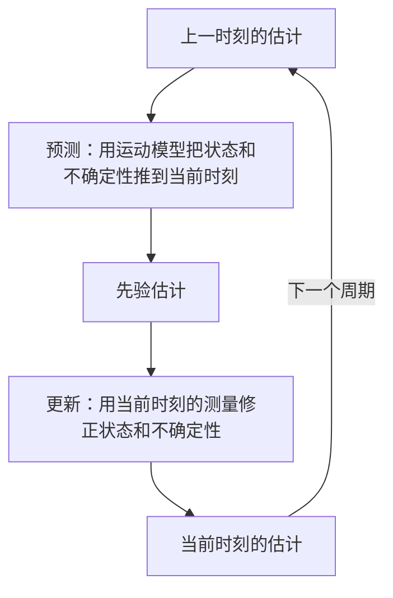
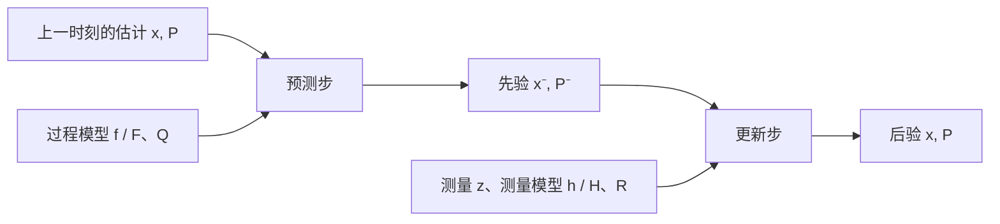

<h1 align="center">Part of KF</h1>

我们常常需要估计一个无法直接测量的量，比如一辆车此刻的位置。车上装了传感器，读数会抖动；我们又大致知道这辆车是怎么运动的，可这个运动模型也不完全准。卡尔曼滤波要回答的问题就是：把这两条都不太可靠的信息合到一起，怎样估计得比任何一条单独用都更接近真值。

这篇文档分三部分。第一部分讲卡尔曼滤波的工程目的，用日常语言说明它每一步在做什么，以及预测和更新为什么交替进行。第二部分把每一步对应的数学写清楚，交代状态、协方差、各个矩阵和向量的含义。第三部分用一个与本题无关的一维例子，把公式落成可以运行的代码，帮助把前两部分串起来。

本文只讲卡尔曼滤波本身。扩展卡尔曼滤波、极坐标观测和本题的具体实现不在其中。

## 目录

- [一、工程目的与预测—更新循环](#sec1)
- [二、数学细节](#sec2)
- [三、一个实现例子](#sec3)

<a id="sec1"></a>
## 一、工程目的与预测—更新循环

### 1.1 两路信息，各有各的不可靠

设想一辆小车沿一条直线行驶，我们想知道它当前的位置。可用信息有两类。

一类来自传感器。它每隔一段时间给出一次位置的测量值，但测量有噪声，连续几次读数会在真实位置附近来回跳动。另一类来自我们对小车运动的了解。如果我们知道它上一次的位置，又知道它大致以什么速度在走，就可以推算它现在大概到了哪里。这个推算不必借助传感器，但同样不精确：速度估计有误差，路面也不一定完全符合假设的运动规律。

单独看，两边都不完整。传感器读数真实，但会抖动；模型推算平滑，却会随时间逐渐偏离真值。卡尔曼滤波把两者按各自的可信程度加权融合，给出一个比两者都更稳、更接近真值的估计。

它之所以比“简单地把两次读数平均一下”更强，是因为它不仅记录一个估计值，还记录这个估计有多不确定。估计越不确定，它就越愿意接受新的传感器数据；估计越有把握，它就越倾向于相信自己的推算。这种“随不确定性自动调整信任比例”的能力，是卡尔曼滤波的核心。

滤波器在算法内部维护一个状态向量，也就是它要估计的那些量，比如位置和速度，同时还维护这些量随时间演化的运动模型。传感器每次送来的外部观测是另一个向量，叫观测向量，只包含它能直接测到的分量。滤波的目的，是让内部这套模型持续跟上外部的真实运动：每来一次观测就用它纠正一次状态，使模型给出的估计与实际运动的偏差越来越小。

### 1.2 预测

每个滤波周期从一个预测开始。预测回答的问题是：在还没有看到本时刻传感器数据之前，根据上一时刻的估计和运动模型，我此刻认为状态是什么？

这里做两件事。第一，把上一时刻的状态估计，按运动模型往前推一步，得到此刻的先验估计。第二，把不确定程度也往前推一步。因为运动模型本身有误差，而且往前推的时间越长误差越大，所以前进之后，不确定性通常比上一时刻更大一些。

预测输出的是一个带不确定性的估计。可以把它理解为“在没看新数据之前，我最好的猜测，以及我对这个猜测有多没底”。

### 1.3 更新

有了预测，接下来看这一时刻的传感器数据。更新回答的问题是：现在拿到了一次测量，怎么修正刚才的预测？

做的判断是：预测的位置和测量值之间差了多少，然后根据“预测有多不确定”和“测量有多不准”来决定这次测量应该被采纳多少。

- 如果预测很没底，而传感器比较可靠，就多听测量的，估计向测量值靠拢。
- 如果预测很有把握，而传感器一向很飘，就少听测量的，估计基本保持预测值。

这个“该听多少”的比例就是卡尔曼增益。它每一步都要根据两边的协方差现算，并不是一个固定常数，这正是滤波能够自适应的地方。

修正之后，我们得到此刻的后验估计，同时把不确定性也更新一次。因为多融合了一条信息，后验的不确定性一般比先验更小。

### 1.4 循环

预测和更新交替进行，构成循环：



每一个周期消耗一次测量，产出一个更可信的估计。下一个周期又把这次的估计当作起点，继续预测、继续更新。传感器的频率可以和模型推进的频率不同：没有测量的时候就只做预测，有测量的时候再做一次更新。

### 1.5 什么时候用不了

卡尔曼滤波的结论建立在一组假设上：噪声大致是零均值的高斯噪声；系统的运动可以用（可能随时间变化的）线性关系描述；过程噪声和测量噪声相互独立。越接近这些假设，效果越好。

如果运动模型或测量关系是非线性的，就需要扩展卡尔曼滤波或别的变体；如果噪声分布严重偏离高斯，标准卡尔曼滤波会退化。本文只讨论线性情形，非线性留给 `Part_of_EKF.md`。

<a id="sec2"></a>
## 二、数学细节

下面把第一部分每一步对应的公式写清楚。约定用下标 $k$ 表示第 $k$ 个时刻，$x_k$ 是状态向量，$P_k$ 是它的协方差矩阵。整个计算是一条从上一时刻的估计到当前时刻估计的流水线：



### 2.1 状态向量、观测向量与协方差

卡尔曼滤波在每个时刻维护两样东西：一个状态向量，和它对应的协方差矩阵。

状态向量 $x_k$ 是要估计的量，写成列向量。分量个数由问题决定：只估计位置是一维，位置加速度是二维，再加加速度就是更多维。一维位置例子里它包含位置和速度：

$$
x_k = \begin{bmatrix} p_k \\ v_k \end{bmatrix}
$$

观测向量 $z_k$ 是传感器在时刻 $k$ 给出的测量，也是列向量。它的维度由传感器决定，通常和状态向量的维度不同。如果传感器只测位置，那么 $z_k$ 是一维的，只装一个数。状态向量是滤波器最终要维护和输出的量；观测向量只是一路输入，要经过更新步才会影响状态。

状态协方差矩阵 $P_k$ 描述状态估计的不确定程度：

$$
P_k = \mathbb{E}\left[(x_k - \hat{x}_k)(x_k - \hat{x}_k)^\mathsf{T}\right]
$$

对角线元素是各分量的方差，非对角线元素是两个分量之间的相关性。$P$ 越小，表示估计越有把握。第一部分反复提到的“不确定性”，在数学上就是 $P$。

为了区分“预测得到的”和“更新得到的”，用上标 $- $ 表示预测（先验），不加表示更新（后验）：

- $\hat{x}_k^-$：进入本时刻测量之前的状态估计
- $P_k^-$：对应的协方差
- $\hat{x}_k$：融合测量之后的估计
- $P_k$：对应的协方差

### 2.2 过程模型：函数 $f$ 与矩阵 $F$

过程模型描述状态怎样随时间演化。用函数 $f$ 表示：

$$
x_k = f(x_{k-1}) + w_{k-1}
$$

其中 $w$ 是过程噪声，代表运动模型没刻画到的部分。在一维例子里，如果假设速度在两个采样间隔之间不变，那么：

$$
f(x_{k-1}) = \begin{bmatrix} p_{k-1} + v_{k-1}\,\Delta t \\ v_{k-1} \end{bmatrix}
$$

当 $f$ 是线性函数时，可以直接写成矩阵乘法：

$$
f(x) = F x
$$

这里的 $F$ 就是状态转移矩阵。上面这个匀速模型对应：

$$
F = \begin{bmatrix} 1 & \Delta t \\ 0 & 1 \end{bmatrix}
$$

需要分清 $f$ 和 $F$：$f$ 是“状态怎样演化”这个函数本身；$F$ 是它在线性情况下对应的矩阵。线性系统里 $f(x) = F x$，两者是一回事的两种写法。在非线性系统里没有这样的矩阵，只能用 $f$ 本身，或者用它在某点附近的一阶近似（这就是 EKF 里的 $F$，见 `Part_of_EKF.md`）。

### 2.3 过程噪声：矩阵 $Q$

过程噪声的协方差是 $Q$。它回答的是：在不看测量的情况下，仅凭模型往前推，模型本身可能带来多大误差。

$Q$ 取值要反映真实情况。取太小，滤波器会过度相信模型，测量来了也不怎么修正，结果容易跟不上目标的实际变化；取太大，滤波器会过度相信测量，把测量的抖动也一并放进估计里，结果不平滑。$Q$ 通常和采样间隔有关，间隔越长，模型外推越久，误差累积得越多。

### 2.4 测量模型：函数 $h$ 与矩阵 $H$

测量模型描述测量值和状态之间的关系。用函数 $h$ 表示：

$$
z_k = h(x_k) + v_k
$$

$z_k$ 是第 $k$ 次的测量值，$v_k$ 是测量噪声。线性情况下：

$$
h(x) = H x
$$

$H$ 叫测量矩阵。在最简单的情形里，传感器直接测位置，那么：

$$
H = \begin{bmatrix} 1 & 0 \end{bmatrix}
$$

它把二维状态 $[p, v]^\mathsf{T}$ 投影成只含位置的一维测量。

和 $f$、$F$ 的关系一样，$h$ 是测量关系本身，$H$ 是它在某点处的线性（或一阶近似）系数。非线性测量，比如雷达给出的是距离和角度，$h$ 里就会出现开方和 $\mathrm{atan2}$，此时没有恒定的 $H$，只能每次在当前状态附近求导得到局部 $H$。

### 2.5 测量噪声：矩阵 $R$

测量噪声的协方差是 $R$。它描述传感器本身有多不准。测量噪声越大，$R$ 越大，滤波器就越不信任这一次测量。

$R$ 通常来自传感器的标定或数据统计：如果观测在真值附近的抖动标准差是 $\sigma$，在一维情况下 $R = \sigma^2$。多维测量时 $R$ 是一个矩阵，对角线是各测量分量的方差。

$Q$ 和 $R$ 的相对大小决定了滤波器更偏向模型还是更偏向测量，这也是调试卡尔曼滤波时最常调的两个量。

### 2.6 时间步 dt

预测步里的 $\Delta t$ 是相邻两次观测之间的时间间隔，不是写死的常数。**它由这两帧观测各自的时间戳相减得到**：

$$
\Delta t = t_k - t_{k-1}
$$

$t_k$ 和 $t_{k-1}$ 是这两帧观测消息自带的时间戳，通常是传感器采样的时刻。这里要用观测时间戳，而不是代码里“处理消息时的当前时刻”。消息从采样到被处理之间有延迟，而且每帧的延迟不一定相同，如果改用本地时钟相减，得到的间隔会和真实间隔有出入，这个误差会累积进状态和协方差。

实现上的做法是保存上一帧观测的时间戳，每来一帧就相减得到 $\Delta t$，再把 $\Delta t$ 传进预测步，用来现算 $F(\Delta t)$ 和 $Q(\Delta t)$。因为传感器频率会抖动、消息到得或早或晚、观测还可能中断，$\Delta t$ 每一帧都可能不同，所以它必须逐帧计算，不能沿用上一帧的值。如果某一帧的间隔明显偏大，说明中间丢帧或观测中断，这时通常要重新初始化，而不是拿一个过大的 $\Delta t$ 直接往前推。

### 2.7 预测步

预测步只用到上一时刻的结果，不需要本时刻的测量：

$$
\hat{x}_k^- = F\,\hat{x}_{k-1}
$$

$$
P_k^- = F\,P_{k-1}\,F^\mathsf{T} + Q
$$

第一条把状态按模型往前推。第二条把协方差也往前推：先由 $F P F^\mathsf{T}$ 把旧的不确定性传导过来，再加上过程噪声 $Q$，所以推进之后不确定性一般会变大。

### 2.8 更新步

更新步需要本时刻的测量 $z_k$。

先算残差，也叫新息，记作 $r_k$。它是测量值与“用预测状态算出来的测量”之差：

$$
r_k = z_k - h(\hat{x}_k^-)
$$

线性情况下 $h(\hat{x}_k^-) = H \hat{x}_k^-$。残差反映的是：传感器这次告诉我们的事情，和预测有多大的出入。

再算残差的协方差 $S$：

$$
S_k = H_k\,P_k^-\,H_k^\mathsf{T} + R
$$

它同时包含预测的不确定性和测量噪声。$S$ 越大，出现较大的残差就越正常。

卡尔曼增益 $K$ 由此得出：

$$
K_k = P_k^-\,H_k^\mathsf{T}\,S_k^{-1}
$$

$K$ 是整套公式里最关键的一步。它把残差换算成对状态的修正量，并且自动权衡了 $P^-$（预测有多不确定）和 $R$（测量有多不准）。可以记住两个极限：$R$ 趋于零时，$K$ 增大，估计几乎完全采用测量；$P^-$ 趋于零时，$K$ 减小，估计几乎完全保持预测。

有了 $K$，更新状态和协方差：

$$
\hat{x}_k = \hat{x}_k^- + K_k\,r_k
$$

$$
P_k = (I - K_k\,H_k)\,P_k^-
$$

第一条用残差修正预测。第二条说明：融合一次测量之后，不确定性通常会减小，因为多知道了一条信息。

最后一条协方差公式在浮点运算下会逐渐丧失对称性，长时间运行可能出问题。工程实现里常用等价的 Joseph 形式：

$$
P_k = (I - K_k H_k)\,P_k^-\,(I - K_k H_k)^\mathsf{T} + K_k\,R\,K_k^\mathsf{T}
$$

它在数值上更稳定，代价是计算量略大。

### 2.9 预测与更新的区别

把两步放在一起对照，区别就清楚了。

| | 预测（predict） | 更新（update） |
|---|---|---|
| 是否需要测量 | 不需要 | 需要当前测量 |
| 用到的关系 | 过程模型 $f$、$F$、$Q$ | 测量模型 $h$、$H$、$R$ |
| 状态变化 | 按模型外推 | 用残差修正 |
| 协方差变化 | 通常变大 | 通常变小 |
| 输出 | 先验 $\hat{x}^-,\,P^-$ | 后验 $\hat{x},\,P$ |

预测把时间往前推进并放大不确定性，更新把测量带进来并压缩不确定性。一个周期里先预测、后更新，两者交替，这就是 1.4 节那个循环的数学形式。

<a id="sec3"></a>
## 三、一个实现例子

下面用一个与本题无关的例子把公式落实成代码：一辆小车沿直线行驶，传感器每隔 $\Delta t$ 测量一次位置，状态取位置和速度两个分量。这个例子的物理场景、传感器类型和坐标系都和本题不同，作用只是演示卡尔曼滤波的结构。

### 3.1 场景设定

- 状态：$x = [p, v]^\mathsf{T}$，位置和速度
- 测量：传感器直接给出位置，测量矩阵 $H = [1 \ 0]$
- 采样间隔：$\Delta t = 0.1$ 秒
- 过程噪声：速度会有小的随机扰动，用 $Q$ 描述
- 测量噪声：传感器标准差约 $0.2$ 米，因此 $R = 0.2^2$

### 3.2 代码

```python
import numpy as np

dt = 0.1

# 状态转移矩阵：匀速模型的 F
F = np.array([[1, dt],
              [0, 1]])

# 测量矩阵：只测位置
H = np.array([[1, 0]])

# 过程噪声协方差 Q：速度上的不确定度
q = 0.05
Q = np.array([[dt**3 / 3, dt**2 / 2],
              [dt**2 / 2, dt]]) * q

# 测量噪声协方差 R
R = np.array([[0.2**2]])

# 初始状态与协方差
x = np.array([0.0, 0.0])          # 位置 0，速度 0
P = np.eye(2) * 1.0               # 一开始都不确定


def predict(x, P):
    # 用模型把状态和协方差往前推一步
    x = F @ x
    P = F @ P @ F.T + Q
    return x, P


def update(x, P, z):
    # z 是本时刻测到的位置
    z = np.array([z])

    # 残差
    r = z - H @ x

    # 残差协方差
    S = H @ P @ H.T + R

    # 卡尔曼增益
    K = P @ H.T @ np.linalg.inv(S)

    # 修正状态
    x = x + (K @ r)

    # 修正协方差（这里用标准形式，工程里可换成 Joseph 形式）
    P = (np.eye(2) - K @ H) @ P
    return x, P


# 假设收到一串测量值
measurements = [0.1, 0.35, 0.42, 0.80, 1.05, 1.42]

for z in measurements:
    x, P = predict(x, P)
    x, P = update(x, P, z)
    print(f"pos={x[0]:.3f}  vel={x[1]:.3f}")
```

### 3.3 代码与公式的对应

- `F`、`H`、`Q`、`R` 分别对应 2.2 到 2.5 节里那几个矩阵。
- `predict` 里的两行，就是 2.7 节的 $\hat{x}_k^- = F\hat{x}_{k-1}$ 和 $P_k^- = FP_{k-1}F^\mathsf{T} + Q$。
- `update` 里的 `r`、`S`、`K`，依次对应 2.8 节的残差、残差协方差和卡尔曼增益。
- `x = x + K @ r` 和 `P = (I - KH)P` 是更新步的两条修正公式。
- 主循环里先 `predict` 后 `update`，对应 1.4 节的循环。

### 3.4 可以从这个例子观察到的现象

- 即使测量在抖动，输出的位置比原始测量更平滑，因为滤波器同时用了运动模型。
- 开局几帧 `P` 很大，增益 `K` 也大，估计很快跟随测量；随着周期推进，`P` 变小，估计更稳，对新测量的反应变得平缓。
- 把 `Q` 调大，输出会更贴近测量、更抖；把 `R` 调大，输出会更平滑但更滞后。这和 2.5 节说的方向一致。

这个例子用的都是线性关系，实现上也比较直接。当测量关系变成非线性、比如测的是距离和角度而不是坐标时，公式里的 $h$ 就不能再写成 $Hx$，需要另外处理。那部分内容在 `Part_of_EKF.md`。

---

祝顺利 😊😊😊

<div align="right">—— 浙江大学 RoboMaster 算法组</div>
