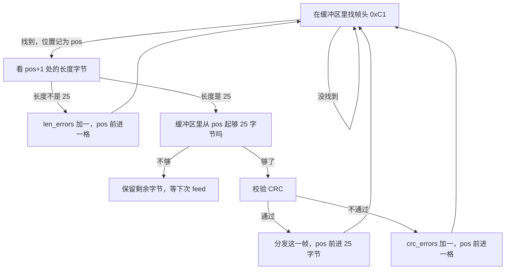

<h1 align="center">Part of Serial</h1>

这份文档讲上位机和下位机之间那条串口线上到底传了什么、怎么传。它对应题目里 `gimbal_serial_driver` 的 `protocol.cpp`：把 ROS 话题编码成二进制帧发下去，把收到的二进制帧解析成话题上来。系统层面的分工和时延在 `Part_of_Communication.md` 里，这份只讲字节。

读完之后，你应该能写出 C2 命令帧的编码、C1 反馈帧的解码，以及处理半包、粘包和错误字节的流式解析器。

## 目录

- [一、什么是串口，串口用来做什么](#sec1)
- [二、帧结构](#sec2)
- [三、字节序与数值编码](#sec3)
- [四、CRC8 校验](#sec4)
- [五、发和收的字段](#sec5)
- [六、编码与解码](#sec6)
- [七、流式解析与重同步](#sec7)
- [八、怎么验证协议写对了](#sec8)
- [九、往返时延怎么测](#sec9)

<a id="sec1"></a>
## 一、什么是串口，串口用来做什么

串口（UART）是最简单的一种通信接口：两根信号线，一根发（TX）、一根收（RX），加上共地。它以固定的速率把二进制位一位一位地推出去，比如本题用的 115200，表示每秒 115200 位，配合 8 位数据、无校验、1 位停止位，也就是常说的 **115200 8N1**。上位机用 USB 转 TTL 模块把 USB 变成串口电平，接到 C 板上。

串口有一个关键特点：**它是一条字节流，本身没有「消息」的概念**。发送方 `write` 了 18 个字节，接收方 `read` 可能一次拿到 5 个、一次拿到 20 个，也可能把两次发送的字节连在一起拿到。哪几个字节算一条消息，串口不关心，得由上层协议自己约定。

本题的「上层协议」就是 C1/C2 帧格式。它规定了：

- 一帧从哪个字节开始（帧头）；
- 这一帧有多长（长度字节）；
- 数据放在哪（载荷）；
- 怎么判断这一帧没有传错（CRC 校验）。

上位机这一侧的串口驱动，工作就是**在这条字节流和 ROS 话题之间来回转换**：把 `gimbal/cmd` 编码成 C2 发出去，把收到的字节流解析成 C1 帧，转成 `gimbal/feedback` 发上来。它不做估计，也不做控制，只是一个翻译层。

顺带一提，串口驱动还发布一个 `serial/status` 话题，每秒一次，报告收发帧数、CRC 错误数、往返时延等，是纯统计信息，给 Foxglove 的 Plot 面板看，不参与控制。

<a id="sec2"></a>
## 二、帧结构

C1 和 C2 用同一套帧结构，四段：

$$
\underbrace{\text{Header}}_{1\ \text{字节}} \quad
\underbrace{\text{Length}}_{1\ \text{字节}} \quad
\underbrace{\text{Payload}}_{N\ \text{字节}} \quad
\underbrace{\text{CRC8}}_{1\ \text{字节}}
$$

| 偏移 | 字段 | 长度 | 说明 |
|---|---|---:|---|
| 0 | Header | 1 | 包 ID，同时是这个协议的帧头 |
| 1 | Length | 1 | **整帧长度**，等于载荷长度加 3 |
| 2 … N+1 | Payload | N | 载荷 |
| N+2 | CRC8 | 1 | 覆盖 byte 0 到 byte N+1 |

长度字节是这套协议里最容易记错的地方：它写的是**整帧的长度**，不是载荷的长度。对 C2 来说，载荷 15 字节，整帧 18 字节，所以 Length 字段填 18。接收方一读到 Length，就知道还要再等多少字节才凑满一帧。

帧头区分方向：`0xC2` 是上位机发给下位机的命令帧，`0xC1` 是下位机回给上位机的反馈帧。

<a id="sec3"></a>
## 三、字节序与数值编码

帧里的字段有单字节、浮点、有符号整数几种，多字节的字段要约定字节顺序。

**多字节整数用小端序**：低位字节在前。比如 `uint32` 的 `0x12345678`，在线上是 `78 56 34 12`。`int16` 也按小端，先按无符号的两字节读出来，再按补码解释成有符号。

**浮点数按 IEEE-754 单精度**：`float` 在内存里就是 32 个二进制位，传输时按位原样搬过去，不是转成字符串。比如 `0.25f` 的位模式是 `0x3E800000`，小端发出去就是 `00 00 80 3E`。

写和读的时候，通常各用一个小的辅助对象，把「往缓冲区按顺序追加字段」和「从缓冲区按顺序取出字段」封装起来：

```text
Writer：u8 / u16 / u32 / f32  ——  追加并推进写指针
Reader：u8 / u16 / u32 / f32  ——  读取并推进读指针
```

这样编码就是「按字段顺序依次 `w.u8(...)`、`w.f32(...)`」，解码就是「依次 `r.f32()`、`r.u8()`」，不用手工算偏移，也不容易错位。

读 `float` 时不要用 `reinterpret_cast` 把指针强转，那样有对齐和严格别名的问题。标准做法是先把 4 个字节拼成 `uint32`，再用 `memcpy` 把这 4 个字节拷进 `float`：

```cpp
uint32_t u = r.u32();
float v;
std::memcpy(&v, &u, sizeof(v));
```

这是位级转换，可移植、不依赖平台的对齐和大小端假设。

<a id="sec4"></a>
## 四、CRC8 校验

串口可能受干扰，或者某一段字节没发全。为了能发现传错，每帧末尾放一个字节的校验码，覆盖帧头和载荷。

本题用的 CRC8 参数是：

```text
多项式  0x07     （x^8 + x^2 + x + 1）
初值    0x00
输入反转  否
输出反转  否
结果异或  否
```

计算时从初值 0 开始，逐字节处理：把当前值异或上这一字节，再看最高位决定怎么移位和异或多项式。工程里一般预先算一张 256 项的查找表，运行时每个字节一次查表，比按位循环快：

```cpp
uint8_t crc = 0x00;
for (每个字节 b) {
    crc = table[crc ^ b];
}
```

校验范围是从 Header 到 Payload 的最后一个字节，也就是整帧除去最后一个 CRC 字节。接收方收到一帧后，对自己算一遍，和帧尾那一个字节比对，一致才算这一帧有效。

有一个用于自检的标准值：对字符串 `"123456789"`，这套参数算出来是 `0xF4`。如果自己写的 CRC 算出来不是这个数，说明参数或实现有问题。

<a id="sec5"></a>
## 五、发和收的字段

### 5.1 C2 命令帧（PC → MCU）

整帧 18 字节，`Length = 18`。

| 偏移 | 字段 | 类型 | 说明 |
|---:|---|---|---|
| 0 | Header | u8 | `0xC2` |
| 1 | Length | u8 | `18` |
| 2 | yaw | f32 | 目标 yaw，rad，云台系 |
| 6 | yaw_vel | f32 | 角速度前馈，rad/s |
| 10 | mode | u8 | 见下表 |
| 11 | flags | u8 | 见下表 |
| 12 | seq | u8 | 逐帧加 1，255 后回到 0 |
| 13 | host_time_ms | u32 | 上位机时钟，下位机原样回传 |
| 17 | CRC8 | u8 | |

`mode`：`0` RELAX（卸力）、`1` TRACK（跟随 yaw）、`2` HOLD（保持当前角度）。

`flags` 位：bit0 target_valid（目标有效）、bit1 laser_on（请求开激光）、bit2 outlier（本帧是离群点）。

### 5.2 C1 反馈帧（MCU → PC）

整帧 25 字节，`Length = 25`。

| 偏移 | 字段 | 类型 | 说明 |
|---:|---|---|---|
| 0 | Header | u8 | `0xC1` |
| 1 | Length | u8 | `25` |
| 2 | yaw | f32 | 电机实测角度，rad，云台系 |
| 6 | yaw_vel | f32 | 电机实测角速度，rad/s |
| 10 | yaw_ref | f32 | 限幅后真正送进控制环的参考 |
| 14 | current | int16 | 电机转矩电流原始值 |
| 16 | temperature | u8 | 电机温度，°C |
| 17 | state | u8 | 下位机状态，见下表 |
| 18 | error_flags | u8 | 见下表 |
| 19 | echo_seq | u8 | 最近采纳的 C2.seq |
| 20 | echo_host_time_ms | u32 | 最近采纳的 C2.host_time_ms |
| 24 | CRC8 | u8 | |

`state`：`0` SAFE、`1` ARMED、`2` TIMEOUT、`3` FAULT。

`error_flags` 位：bit0 电机离线、bit1 过温、bit2 指令被钳位、bit3 指令超时、bit4 非有限浮点、bit5 CAN 错误、bit6 串口错误、bit7 上次复位来自看门狗。

`echo_seq` 和 `echo_host_time_ms` 是为了让上位机能确认「下位机到底收到了哪一帧」，以及测算往返时延，第九节展开。

<a id="sec6"></a>
## 六、编码与解码

协议实现里有四类函数，按方向和帧类型区分：

| 函数 | 帧 | 方向 | 谁用 |
|---|---|---|---|
| `encodeCommandC2` | C2 | PC → MCU | 上位机编码命令 |
| `decodeFeedbackC1` | C1 | MCU → PC | 上位机解析反馈 |
| `encodeFeedbackC1` | C1 | MCU → PC | fake MCU 模拟下位机发反馈 |
| `decodeCommandC2` | C2 | PC → MCU | fake MCU 模拟下位机收命令 |

**上位机真正要写的是前两个**：把 `gimbal/cmd` 编成 C2 发下去，把收到的 C1 解成 `gimbal/feedback`。

后两个是**参考方向**，给软件下位机 `fake_mcu` 用。真实运行时上位机用不到它们，但有两个作用：一是 `fake_mcu` 要模拟下位机，得会收 C2、会发 C1；二是单元测试用它做交叉验证——用一边编码、另一边解码，确认两个方向一致。

编码就是按第五节的字段表，从头字段到尾字段依次写入，最后补 CRC。解码反过来：先检查帧头和长度对不对，CRC 过不过，再按字段表依次读取。解码函数开头通常调用一个统一的检查函数，把「指针非空、长度匹配、帧头匹配、CRC 正确」四件事一次判掉，避免每个字段各自判断。

<a id="sec7"></a>
## 七、流式解析与重同步

这是协议里最容易出错的一环，也是题目重点。

串口 `read` 回来的字节数是不定的，所以一次拿到的数据可能是：

- **半包**：一帧只到了一部分，后面几个字节下次才到；
- **粘包**：一次到了两帧甚至更多；
- **有垃圾**：帧前面混进一些无关字节；
- **长度错**：某个候选帧头的第二个字节不是期望的长度；
- **CRC 错**：整帧凑齐了，但校验不过。

解析器的做法是维护一个缓冲区，`feed` 进来的字节先追加到末尾，然后从头扫描：



**重同步规则是这套解析器唯一的关键点，也是最容易写错的地方。**

当长度不对或 CRC 不过时，处理方式不能是「把整个缓冲区清空」，而要**只丢掉当前这个候选帧头这一个字节，从它的下一个字节重新找帧头**。

原因在于：被当作帧头的那个 `0xC1`，可能只是上一帧载荷里碰巧出现的一个字节，真正的帧头还在它后面。如果整段清空，紧随其后的正常帧会被一起丢掉。只有逐字节向后重试，才能把帧头重新对齐。

用一个场景说明：缓冲区里是

```text
... 0xC1 55 ... 后面跟着一帧正常的 C1 ...
```

第一个 `0xC1` 后面是 `0x55`，长度不对。此时解析器丢掉这个 `0xC1`，从 `0x55` 继续找，很快就能找到后面那个真正的 `0xC1`，把正常帧解析出来。如果这里清空缓冲区，那一帧就丢了。

上位机这一侧只需收 C1，所以解析器只认一种帧头（`0xC1`）和一种长度（`25`），比同时处理两种帧简单。统计上，`frames_ok`、`crc_errors`、`len_errors`、`skipped_bytes` 分别记录成功帧数、CRC 错误数、长度错误数和跳过的字节数，最终汇总到 `serial/status`。

<a id="sec8"></a>
## 八、怎么验证协议写对了

协议有两个独立实现：上位机是 C++，下位机是 C。两边各写各的，怎么保证字节级一致？靠两组测试。

**第一组：黄金字节向量。** 对一组确定的输入，预先算好它应该编码成什么字节，当作标准答案。例如 C2 帧，给定

```text
yaw = 0.25, yaw_vel = -1.5, mode = TRACK,
flags = target_valid | laser_on, seq = 7, host_time_ms = 0x12345678
```

编码器必须逐字节输出：

```text
C2 12 00 00 80 3E 00 00 C0 BF 01 03 07 78 56 34 12 8C
```

只要有任何一个字节不同，测试就失败。它能挡住字节序写反、float 位模式没搬对、CRC 参数不对、长度字段或字段顺序错这些问题。C1 帧同理，工程里给了对应的向量。

**第二组：交叉编解码。** 用一边编码，用另一边解码，检查字段能否还原。比如用学生写的 `encodeCommandC2` 编一帧，再用参考的 `decodeCommandC2` 解出来，比对 `yaw`、`mode` 等字段；反过来，用参考的 `encodeFeedbackC1` 编，用学生写的 `decodeFeedbackC1` 解。这样保证「编」和「解」两个方向互相自洽，而不只是各自不报错。

两组测试合起来，才能说明协议实现和参考一致。自己改完 `protocol.cpp` 之后，跑一遍单元测试，就能知道写对没有。

<a id="sec9"></a>
## 九、往返时延怎么测

命令帧里有一个 `host_time_ms`，上位机发的时候填自己当前的毫秒时钟。下位机收到后，把它原样放进反馈帧的 `echo_host_time_ms` 里回传。

于是上位机收到一帧 C1 后，用「本机现在的时间」减去 `echo_host_time_ms`，就得到这一帧命令从发出到反馈回来的**往返时延**：

```text
rtt = now_ms - echo_host_time_ms
```

因为 C1 是 100 Hz 回传，命令发出后最多要等 10 ms 才轮到下一帧反馈，所以这个 `rtt` 含有一段最多 10 ms 的等待，是单程延迟的一个上界。它不是精确的单程时延，但足够用来给 `predict_dt` 定方向——量级对了，提前量才有意义。

如果一段时间里 `echo_host_time_ms` 始终是同一个值，说明下位机最近没有再采纳新的 C2，上位机就能判断命令没送达。`echo_seq` 也有同样作用：它每跳一下，说明中间至少有一帧没能形成完整的往返。

`serial/status` 里的 `rtt_ms_mean` 和 `rtt_ms_max` 就是这些测量在最近一秒内的均值和最大值，在 Foxglove 的 Plot 面板里可以直接看。

---

祝顺利 😊😊😊

<div align="right">—— 浙江大学 RoboMaster 算法组</div>
